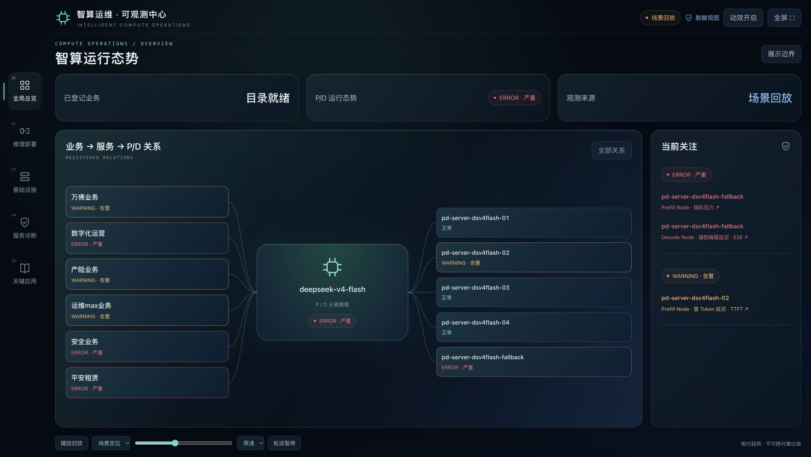
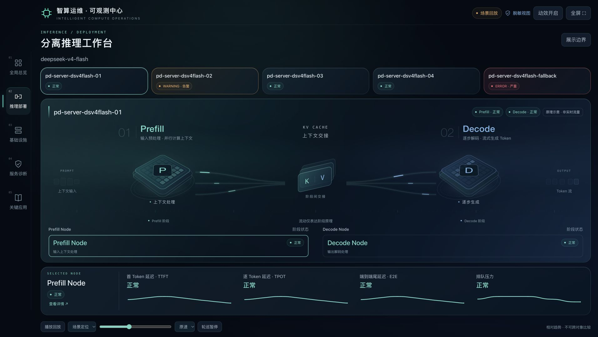
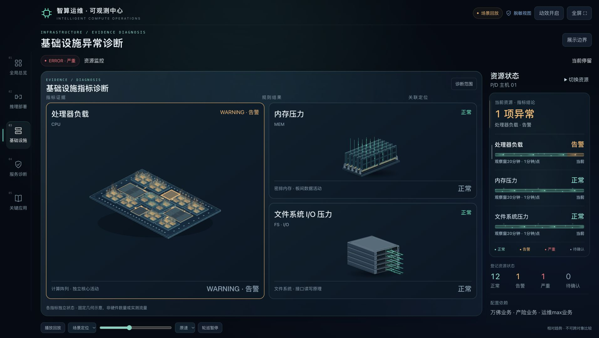
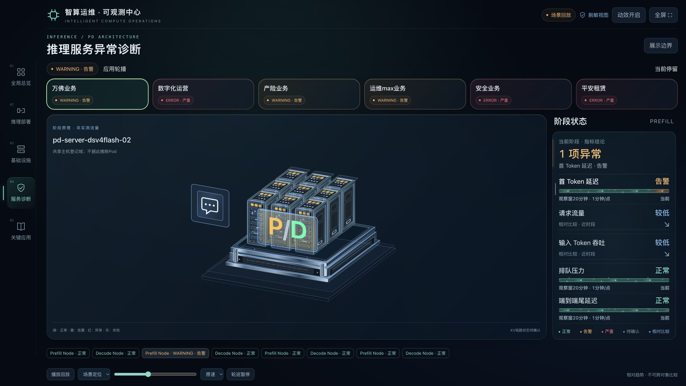
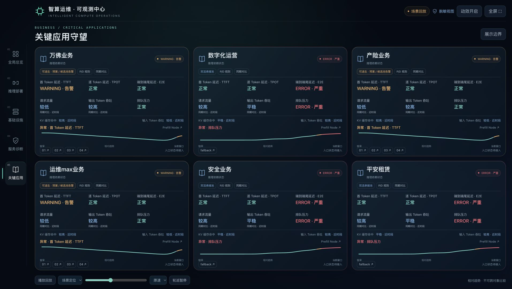
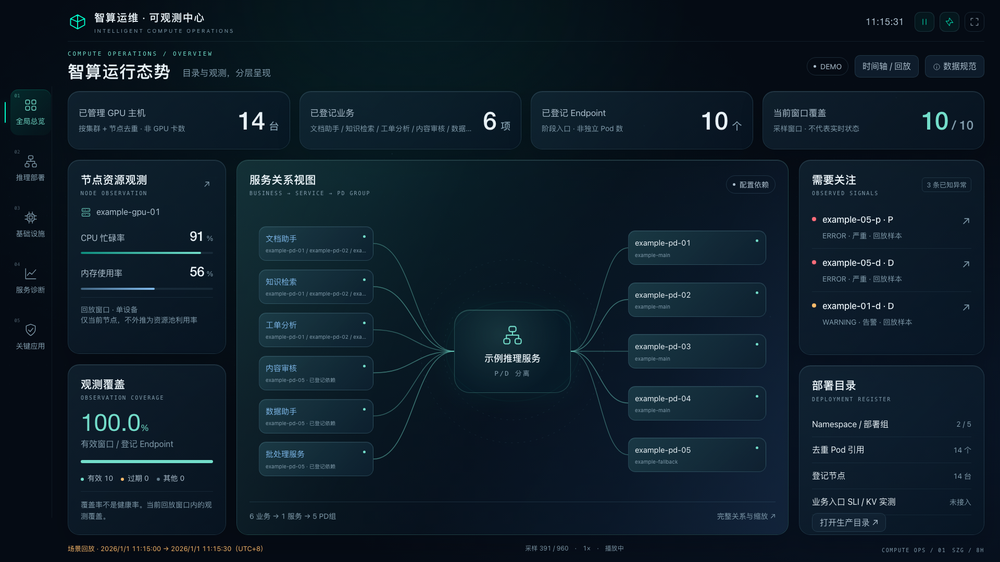
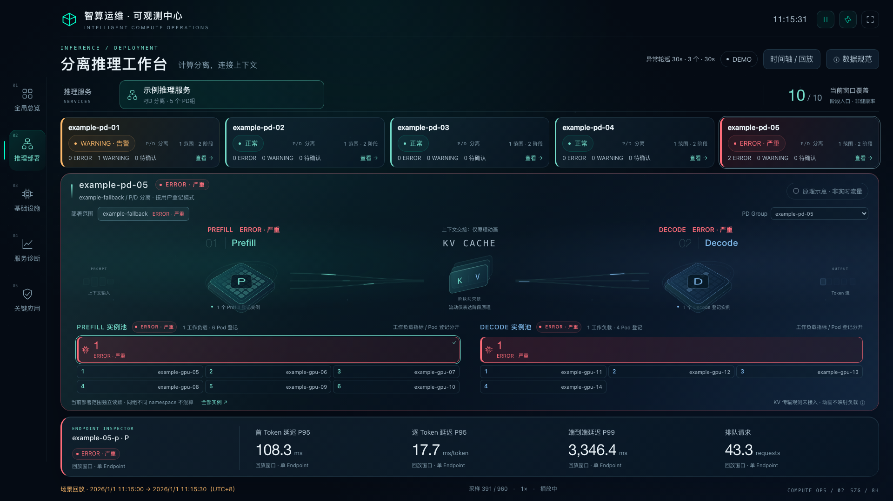
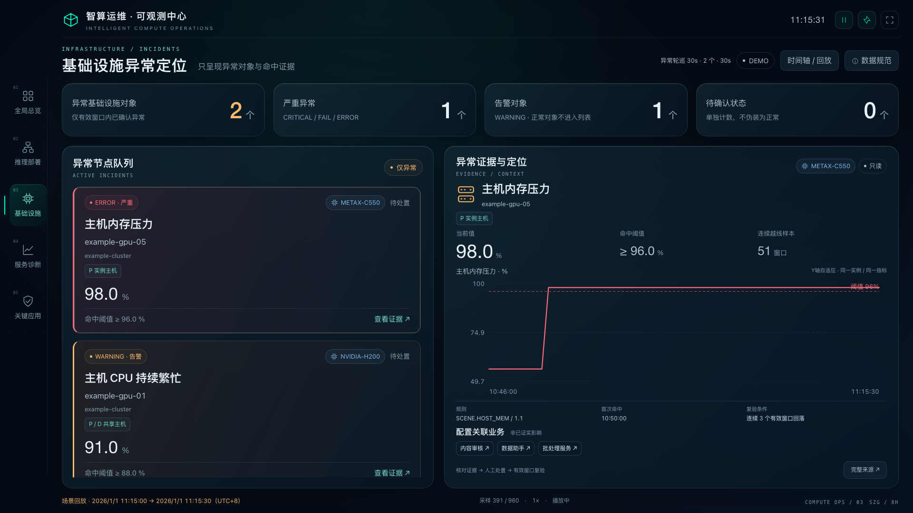
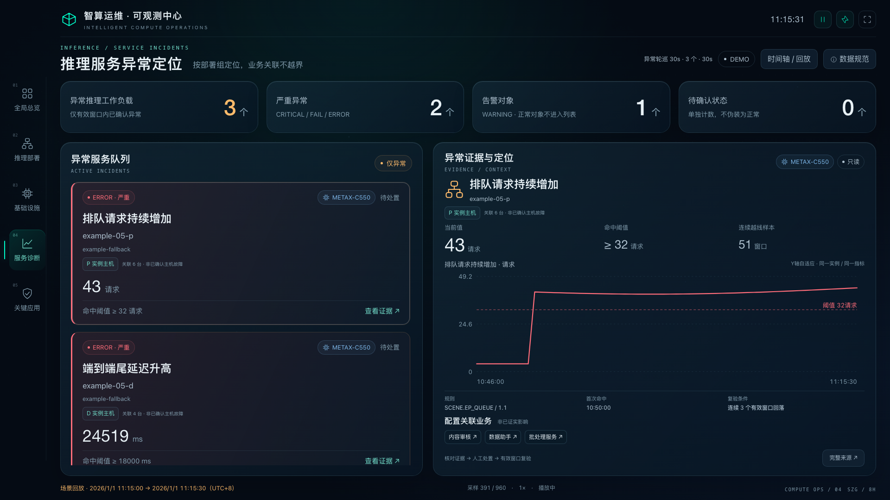
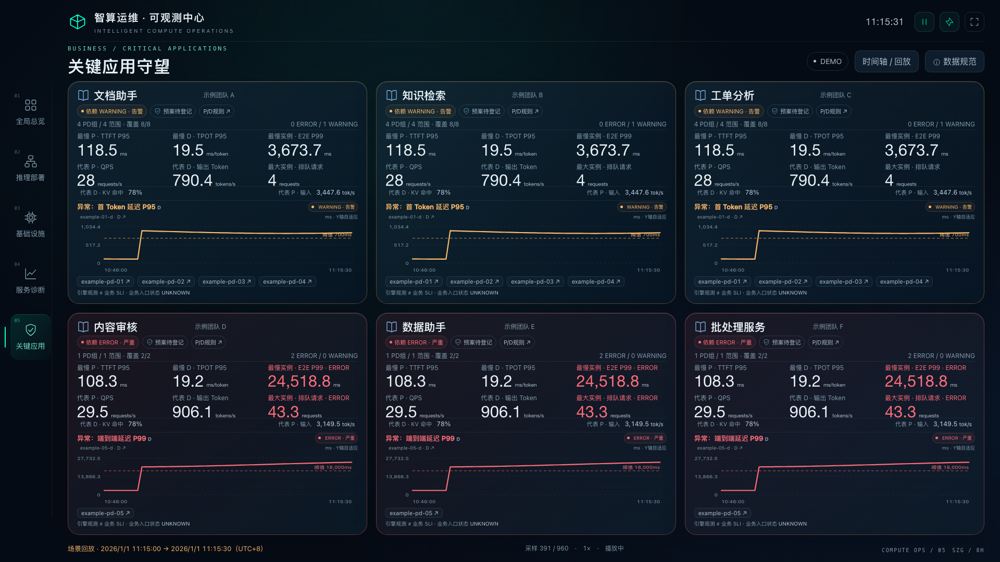

# 智算运维大屏

## v0.8.1 · 分钟状态轨迹

五屏正式脱敏入口为`/screen-masked/?screen=01`至`05`。03保留已确认CPU、内存和存储模型，修复内存/存储动效及开关恢复；右侧显示当前异常、三项状态与已有回放状态轨迹。04保留P/D/KV模型，五项阶段指标同屏，流量/吞吐等相对比较使用文字，替代过矮折线与旧分区仪表。深青蓝玻璃面板保留黄红异常提示及持续轨道粒子及轻微上浮短尾，关键信息无需鼠标键盘展开。

20分钟观察窗以1分钟/点呈现，原生60秒源保留原点；30秒演示数据按真实分钟归并，不插值、不取未来采样。菱形和指定重复说明已移除。

使用同版`masked.v3`脱敏回放：没有原始读数或阈值；相对比较不等于健康判定，光效不代表实测流量。未提供或待确认的数据使用中性色，不补造正常状态。

| 01 全局总览 | 02 推理部署 |
| --- | --- |
|  |  |







### 本地部署包

从[Release](https://github.com/underthedeepsea/intelligent-compute-ops-dashboard/releases/tag/v0.8.1)下载`intelligent-compute-ops-dashboard-v0.8.1-20261030.zip`及同名`.sha256`。包只含脱敏前端、同版回放数据和启动说明，不含数据库、Gateway或私密配置。

完整解压并进入包目录，macOS/Linux执行`sh ./START_LOCAL.sh`，Windows执行`START_LOCAL.cmd`。需要Python3.10+，无pip/npm安装。默认地址：
- `http://127.0.0.1:18771/screen-masked/?screen=03`
- `http://127.0.0.1:18771/screen-masked/?screen=04`

终端保持开启；按Ctrl+C停止本服务。端口占用时在macOS/Linux使用`PORT=18772 sh ./START_LOCAL.sh`；Windows先`set PORT=18772`再启动，并同步修改浏览器端口。不要用file方式双击HTML。`VERSION.json`标识构建与合并提交，`SHA256SUMS`覆盖包内文件。

从源码仅预览脱敏版也可执行`python3 -m http.server 18771 --bind 127.0.0.1 --directory frontend`。Django与Nginx挂载只开放21个已列明资源，其余路径不作为脱敏资源暴露。

本版已检查03/04在1920×1080与1280×720的正常、告警和真实UNKNOWN、粒子及暂停恢复；01/02/05在1920重新查看。此前来源断开与减少动态模拟不作为本版新验收。电视远距、连续长播、Windows实际运行仍未验收。详细范围见[发布验证说明](docs/masked-minute-release-validation.md)。


**Intelligent Compute Ops Dashboard · v0.7.0**

五屏智算运维界面与 AI Gateway 资源控制台。静态 HTML / CSS / JavaScript 前端，Django API；无需前端构建。当前版本包含 SZG v5 更新、GPU 主机目录、P/D 部署范围、异常趋势、巡播和外部八小时回放。

[Apache 2.0](LICENSE) · [部署说明](deploy/README.md) · [本地包导入](docs/demo-import.md) · [最新 Release](https://github.com/underthedeepsea/intelligent-compute-ops-dashboard/releases/latest)

## 界面预览

以下为当前源码实际渲染的截图，使用独立生成的虚构团队、业务、主机和指标。截图用于介绍界面，不表示生产监控；截图数据不随源码发布。

### 01 全局运维总览



### 02 P/D 运行诊断



### 03 基础设施异常定位



### 04 推理服务异常定位



### 05 关键应用守望



## 本地启动

需要 Python 3.10+；Node.js 用于前端测试。

```bash
git clone https://github.com/underthedeepsea/intelligent-compute-ops-dashboard.git
cd intelligent-compute-ops-dashboard
git checkout v0.7.0
python3 -m venv .venv
source .venv/bin/activate
python -m pip install -r requirements.lock
export CONTROL_LOCAL=1
python backend/manage.py migrate --noinput
python backend/manage.py runserver 127.0.0.1:8767 --noreload
```

大屏：<http://127.0.0.1:8767/screen/>；控制台：<http://127.0.0.1:8767/gateway/>。

初始数据库为空。打开控制台「资源录入」登记团队、业务、模型、集群和整项服务；「手动数据导入」可导入独立的推理或硬件 CSV 快照。字段说明见 [资源录入](docs/catalog-entry.md) 和 [监控数据](docs/monitoring.md)。未接入、未知和过期状态会明确显示；目录关系不代表实际调用、健康或实时流量。

当前应用允许直接读取和修改登记数据，不提供账号、登录或角色授权；部署访问控制需由你的网络入口承担。同源 CSRF、数据关联和版本冲突检查仍启用。

## 本地演示包与升级

GitHub 不包含用户演示载荷、旧版演示种子、原始映射、内部设计文件或生产导入材料。演示包由使用者在本地保存并安装，步骤见 [本地包导入](docs/demo-import.md)。回放数据和普通监控数据隔离；回放须显式开启，标注 SYNTHETIC / SCENARIO 来源和固定采样时间。

从旧版本升级：停止 API 和其他数据库写者，备份数据库，更新同版本 API/Web 源码或镜像，串行执行迁移后启动。当前包含 `control.0001–0006` 和 `production_scene.0001–0005`；迁移不自动安装演示数据。外部场景目录需按导入指南显式检查与应用。

## Docker / Kubernetes

见 [中文部署说明](deploy/README.md) 和 [生产检查清单](docs/deployment-production-checklist.md)。提供 HTTP Web Pod IP:8080 与 NAS PV/PVC + SQLite 配置；Compose 保留 PostgreSQL。API 单副本、单 sync worker，SQLite 写者须串行维护；巡检 worker 默认不部署。

生产需配置应用密钥、Host/origin、NAS 地址和目录、同版本镜像。Release 发布源码归档和校验文件；没有上传容器镜像。实际 NAS 锁、持久性、AMD64 镜像和巡检链路应在目标环境验收。

## 测试

```bash
CONTROL_LOCAL=1 python backend/manage.py test tests production_scene --verbosity 1
node --test frontend/screen/tests/*.test.cjs frontend/gateway/tests/*.test.cjs
node --test prototypes/gateway-entry-flow/directory-core.test.cjs
```

不安装外部样本可执行通用测试，样本相关测试明确显示 skipped。完整本地数据验收需设置 `PRODUCTION_SCENE_DATA_DIR` 和 `PRODUCTION_SCENE_TEST_DATA_REQUIRED=1`。测试夹具为代码验证用的合成小样本，不自动安装进应用。

## 项目结构

| 目录 | 内容 |
| --- | --- |
| backend/ | Django API、目录、观测投影、迁移和测试 |
| frontend/screen/ | 五屏界面、巡播和回放适配 |
| frontend/gateway/ | 资源目录、关联图、整项服务和 CSV 导入 |
| templates/ | CSV 字段模板 |
| deploy/ | Docker / Compose / Kubernetes 配置 |
| contracts/ | 公共接口与数据来源契约 |
| docs/ | 使用、部署和导入说明 |
| prototypes/ | 浏览器本地录入原型，数据不自动同步后端 |

## 历史同步说明

本次经仓库所有者授权清理公开 Git 历史与旧 Tag 中的演示载荷及内部材料；旧提交 SHA 已改变，原历史仅在本地备份。已有克隆请先保存本地改动，再重新克隆。旧 v0.6.0 源码附件同步重新生成。GitHub 缓存、旧 PR 引用及第三方克隆不受 Git 引用重写控制。

## 许可证

本项目源码采用 [Apache License 2.0](LICENSE)。独立保管的数据和内部材料不属于公开源码发布内容。
